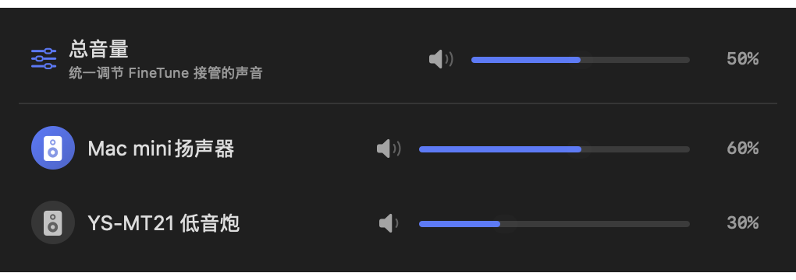
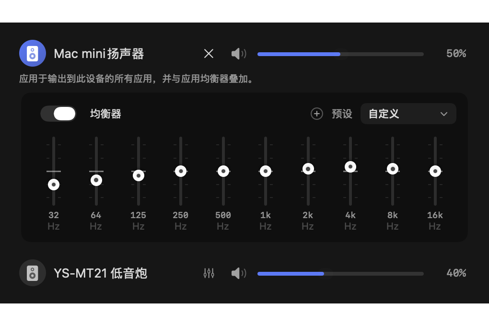

# FineTune Sync

**Get your speakers in time. Turn them up together. Give each one its own sound.**

Your Mac speakers, Bluetooth speaker, USB interface and subwoofer can play together. FineTune Sync helps them work together, too: **delay alignment, one master volume, and separate EQ for every output**. A free, open-source macOS menu bar app, with English and Simplified Chinese UI.

 

**[Download](https://github.com/wait2050/FineTune-Sync/releases/latest)** · [简体中文](README.md) · [Setup guide](OUTPUT_DELAY.zh-CN.md) · [Build notes](OUTPUT_DELAY.md)

## What makes this edition different?

Built on [FineTune](https://github.com/ronitsingh10/FineTune), this fork focuses on listening through several devices at once. It keeps the original app volume, routing and headphone correction features.

| When this happens… | Here is what you can do |
| --- | --- |
| Your Bluetooth speaker arrives late, making the beat sound doubled. | **Align delays.** Add delay to the earlier output, adjust each device independently, or measure the difference with a microphone. |
| You have balanced your speakers and just want everything quieter. | **Use one master volume.** One slider or the volume keys adjust all FineTune-managed playback, preserving app and device levels. |
| One speaker sounds muddy and another has too much bass. | **EQ each output separately.** Give each speaker its own 10-band curve, alongside your app EQ and headphone correction. |

## Get the beat together

Enable delay compensation under Settings → Audio → Multi-device Sound Sync. Each output has a **0–2000 ms** delay, numeric entry, ±10 / ±50 ms buttons and keyboard fine adjustment. Synchronized test playback helps you listen while adjusting.

A wired or USB microphone that can hear both outputs can measure their timing difference. Apply the measured compensation, then listen to confirm. Bluetooth reconnection, audio-mode changes or moving the equipment can require another measurement; this edition does not continuously track changing Bluetooth latency.

## Balance once. Adjust the whole mix afterward.

The output page has a **Master Volume** row. It works across apps routed to one or several devices. Media keys and the HUD slider control that same master, and new playback streams inherit its level and mute state.

The master affects audio managed by FineTune. Ignored or uncaptured apps are outside its scope. At 100%, it preserves the existing level; reducing it attenuates playback without rewriting app or device settings.

## Give every speaker its own EQ

Open the EQ panel beside an output to adjust its **10-band equalizer**. Each device remembers its own curve and bypass state. Device EQ applies to every app routed to that output and combines with app EQ and AutoEQ headphone correction. Outputs with different EQ settings are processed independently.

*Screenshots use sample settings to show the controls; they are not measured device results.*

## Install

Requires an **Apple Silicon Mac (arm64), running macOS 15.4 or later**.

1. Download the ZIP from [this fork’s releases](https://github.com/wait2050/FineTune-Sync/releases/latest), unzip it and move the app to Applications. Quit the previous version before replacing it; existing settings are retained. The app bundle keeps the filename `FineTune Delay.app`.
2. Grant system audio recording permission when prompted. Grant Accessibility permission if you want FineTune to handle the volume keys.
3. Open the menu bar popup and select multiple outputs for an app.
4. Align their delays, balance individual levels and EQ, then use the master for everyday volume changes.

The upstream Homebrew cask and official downloads contain the original FineTune. Download this fork for the additions described here, and run one edition at a time. Releases are locally signed and are not Apple-notarized; follow macOS prompts on first launch.

## The original features are still here

Per-app volume and mute, up to 4× boost, multi-device routing, app EQ, user presets, AutoEQ headphone correction, loudness processing, device priorities, disconnect fallback, Bluetooth management, input volume, shortcuts, scroll-wheel adjustment, and light/dark appearance.

## Help and development

- [Usage guide](OUTPUT_DELAY.zh-CN.md)
- [Microphone calibration and synchronized test playback](CALIBRATION.zh-CN.md)
- [Upstream update workflow](UPSTREAM_SYNC.zh-CN.md)
- [Build and implementation notes](OUTPUT_DELAY.md)
- [Report an issue](https://github.com/wait2050/FineTune-Sync/issues): include your Mac, macOS version, output devices, steps and what you heard.

## Credits

FineTune Sync is a community fork of [FineTune by Ronit Singh](https://github.com/ronitsingh10/FineTune), distributed under the original [GPL-3.0 license](LICENSE). Thanks to the upstream project for its audio foundation and to [AutoEQ](https://github.com/jaakkopasanen/AutoEq) for headphone correction data. You can [support the original author](https://ko-fi.com/ronitsingh10).
