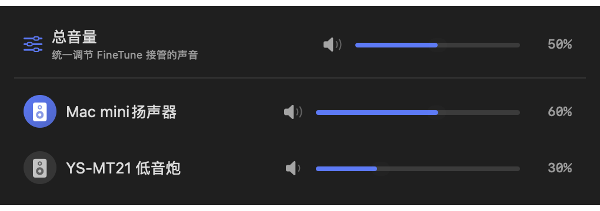
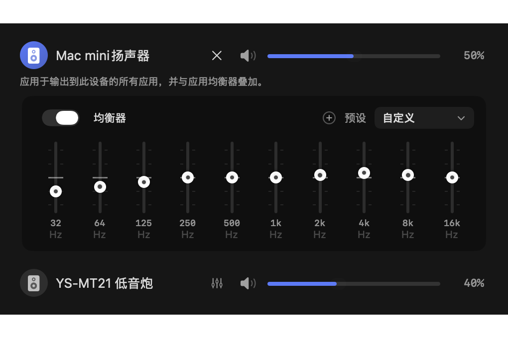

# FineTune Sync

**多台音箱一起放，声音对齐、音量一起调，每台还能单独调音色。**

Mac 内置扬声器、蓝牙音箱、USB 声卡和低音炮，接上了，也该配合得好。FineTune Sync 把多设备播放时最常用的三件事放在一起：**对齐延迟、统一音量、分设备 EQ**。常驻 macOS 菜单栏，免费、开源，支持简体中文。

<br clear="all"/>

**[下载最新版](https://github.com/wait2050/FineTune-Sync/releases/latest)** · [English](README.en.md) · [使用说明](OUTPUT_DELAY.zh-CN.md) · [同步测试与自动校准](CALIBRATION.zh-CN.md)

## 把 MonoSplit 当作一台输出设备

这一版可以把 [MonoSplit](https://github.com/wait2050/MonoSplit) 接入设备列表：**FineTune 管日常播放，MonoSplit 管音箱调音**。MonoSplit 保留独立进程、窗口和配置，无需系统音频驱动。

```text
各个应用 → FineTune 应用音量 / 总音量 / 静音
        → MonoSplit → 单声道混合 → 三路分频 / EQ / 延迟 → 实际扬声器
```

1. 下载 [MonoSplit](https://github.com/wait2050/MonoSplit/releases/latest) 和本仓库支持联动的版本。
2. 在 MonoSplit 配好物理输出，勾选菜单栏中的「FineTune 输入（作为独立设备）」，然后启动处理。
3. 在 FineTune 的输出列表或某个应用的输出选择器里选 **MonoSplit**。设备旁的打开按钮可以显示独立调音窗口。
4. 在 FineTune 调音量和路由，在 MonoSplit 调分频、REW 参数、EQ、极性与延迟。以前手动指定了物理设备的应用，需要单独切到 MonoSplit。

MonoSplit 把输入按 `(L + R) / 2` 混为单声道，适合单声道多路音箱与主动分频。桥接增加约 **40 ms 预缓冲**，还需计入回调、设备及支路延迟；与其他输出合播时应重新检查同步。系统提示音和未被 FineTune 接管的应用继续沿原路径播放。

[中文联动指南](MONOSPLIT.zh-CN.md) · [English integration guide](MONOSPLIT.md) · [MonoSplit 源码](https://github.com/wait2050/MonoSplit)

## 这一版有什么不同？

基于 [FineTune](https://github.com/ronitsingh10/FineTune) 扩展，重点照顾「几台设备一起听」这件事。原版的应用音量、音频路由和耳机校正等功能也都保留。

| 你遇到的情况 | FineTune Sync 怎么帮你 |
| --- | --- |
| 蓝牙音箱晚半拍，和内置扬声器一起放像有回声 | **延迟对齐**：给先出声的设备补一点延迟；每台单独调，也可以用麦克风测量后应用补偿。 |
| 两台音箱的比例刚调好，想把整体声音小一点 | **统一总音量**：拖一个滑块，或按音量键，所有经过 FineTune 的播放一起变；各设备和应用原来的比例保留。 |
| 一台音箱发闷，另一台低频太重 | **每台设备独立 EQ**：分别调音色。同一首歌可以给不同音箱使用不同曲线，也能继续叠加应用 EQ。 |

### 先让鼓点落在一起

在「设置 → 音频 → 多设备声音同步」中打开延迟补偿，给每台输出单独设置 **0–2000 ms** 延迟。支持数字输入、±10 / ±50 ms 按钮和键盘微调，也有同步测试音，方便边听边调。

如果你有能同时听见两台音箱的有线或 USB 麦克风，可以测量它们的时间差，再应用补偿。比如蓝牙音箱慢了约 220 ms，就让内置扬声器多等 220 ms；这只是说明调法，实际数值要按你的设备测量。


### 调好比例，之后只管总音量

输出页顶部新增「总音量」。无论一个应用发往两台音箱，还是多个应用分配到不同设备，都能整体调大、调小或静音。媒体键和浮层滑块控制同一个总音量；新播放流和切换后的输出会继承当前设置。

总音量作用于 FineTune 接管的声音，被忽略或未接管的应用不受影响。100% 保留原有电平，往下调时统一衰减；应用和设备的滑块仍然用于各自的平衡。



### 每只音箱，都有自己的调法

点输出设备旁的 EQ 按钮，展开这台设备的 **10 段均衡器**。想少一点轰头的低频，或把人声调清楚，都可以只改这一台；曲线和开关会分别保存。

设备 EQ 会作用于送往该设备的所有应用，可与应用 EQ、AutoEQ 耳机校正一起使用。不同设备使用不同 EQ 时，各输出会独立处理声音。



*上面的界面图使用测试样例数值展示控件，不代表设备实测结果。*

## 下载与上手

支持 **Apple Silicon Mac（arm64）、macOS 15.4 或更新版本**。

1. 从 [本仓库 Releases](https://github.com/wait2050/FineTune-Sync/releases/latest) 下载 ZIP，解压后把应用放入「应用程序」。已有用户先退出旧版，再替换应用；原设置会保留。安装包中的应用沿用 `FineTune Delay.app` 文件名。
2. 启动后按系统提示授予音频录制权限。需要用 F10 / F11 / F12 接管音量时，再授予辅助功能权限。
3. 点击菜单栏图标，在应用的输出选择器里选中多台设备。
4. 先对齐延迟，再调整每台的音量和 EQ；之后用顶部总音量控制整体。

本仓库的发布包包含上述扩展；Homebrew 的 `finetune` 和官方安装包对应上游原版。请一次只运行一个版本。本发布包使用本地签名，未经 Apple 公证，首次打开可能需要按 macOS 提示确认。

蓝牙重连、切换音频模式或改变摆位后，可能需要重新测量。这里的同步通过测量和延迟补偿实现，目前不会持续追踪蓝牙延迟变化。

## 还有这些熟悉的功能

- 每个应用独立音量、静音和最高 4 倍增益。
- 同时输出到多个设备，或把不同应用送往不同设备。
- 应用 EQ、自定义预设、AutoEQ 耳机校正和响度处理。
- 设备优先级、断线回退、蓝牙设备管理和麦克风音量控制。
- 快捷键、滚轮调节、浅色 / 深色外观和简体中文界面。

## 文档与反馈

- [完整使用说明](OUTPUT_DELAY.zh-CN.md)
- [同步测试音与麦克风自动校准](CALIBRATION.zh-CN.md)
- [如何跟进官方更新](UPSTREAM_SYNC.zh-CN.md)
- [构建与实现说明](OUTPUT_DELAY.md)
- [报告问题或提出建议](https://github.com/wait2050/FineTune-Sync/issues)

遇到问题时，告诉我们你的 Mac、macOS 版本、输出设备，以及「怎么操作、听到了什么」。这些比一句“不同步”更容易帮我们找到原因。

## 开源与致谢

FineTune Sync 是 [Ronit Singh 的 FineTune](https://github.com/ronitsingh10/FineTune) 的社区扩展版，保留原作者署名与 [GPL-3.0 许可证](LICENSE)。感谢上游提供应用音量、路由和音频处理的基础，也感谢 [AutoEQ](https://github.com/jaakkopasanen/AutoEq) 的耳机校正资料。

MonoSplit 自有代码采用 [0BSD](https://github.com/wait2050/MonoSplit/blob/main/LICENSE)。本仓库作为 FineTune 衍生版，整体继续使用 GPL-3.0；独立 PCM 桥接文件的 0BSD 许可见 [第三方声明](THIRD_PARTY_NOTICES.md)。允许商业使用，分发本衍生版时仍须遵守 GPL-3.0 的署名、许可及对应源码要求。

喜欢原版 FineTune，也可以 [支持原作者](https://ko-fi.com/ronitsingh10)。本仓库负责这里的多设备同步、总音量、设备 EQ 与中文扩展。
